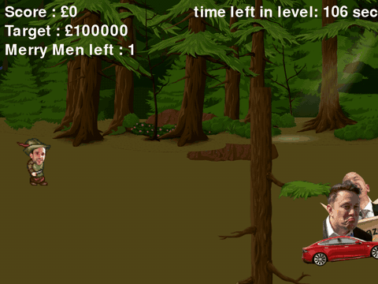
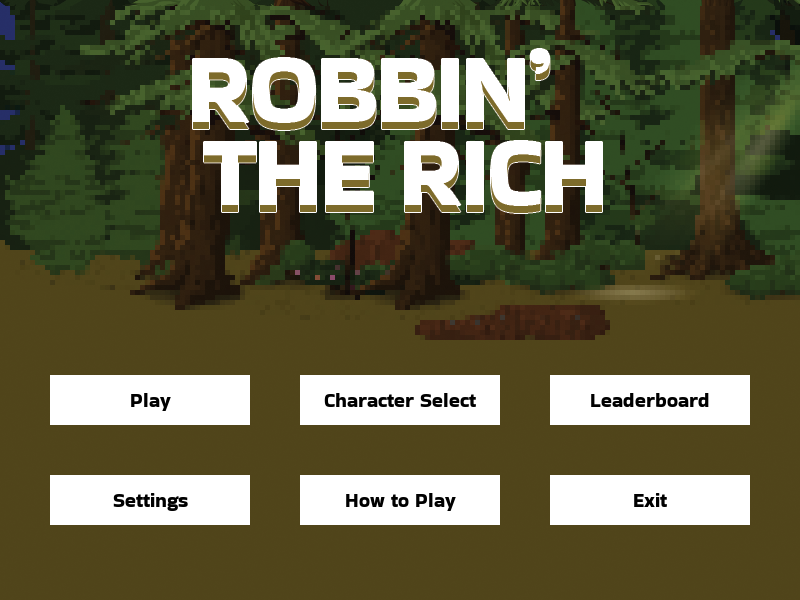
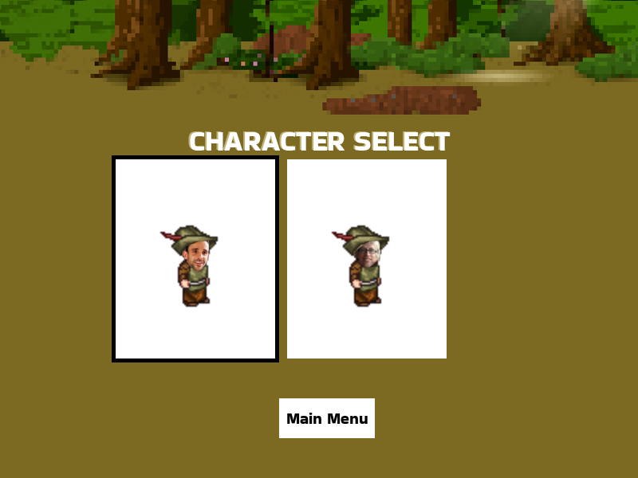
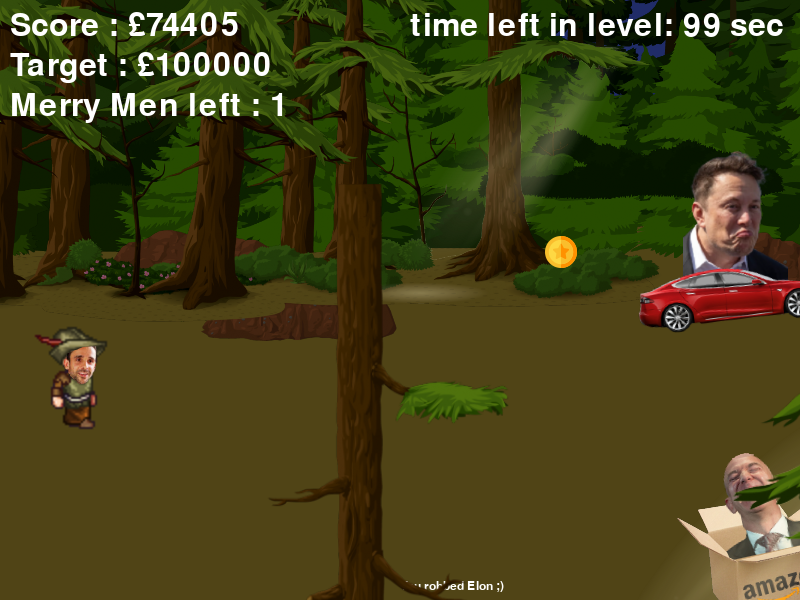

# Robbin' The Rich

A side-scrolling arcade game in Python and [pygame](https://www.pygame.org). You play Robin Hood in
the forest. Shoot the fleeing billionaires, grab the money they drop to save the poor, and dodge
their lawsuits, all before they escape.



| Main menu | How to play |
|---|---|
|  |  |
| **Character select** | **In game** |
|  |  |

## Download

Get the latest build from the [Releases page](../../releases/latest). No Python needed.

| Platform | File |
|---|---|
| macOS, Apple silicon (M1 and later) | `Robbin-The-Rich-macOS-AppleSilicon.zip` |
| macOS, Intel | `Robbin-The-Rich-macOS-Intel.zip` |
| Windows 10/11 | `Robbin-The-Rich-Windows-x64-setup.exe` (installer) or `-portable.zip` |
| Linux x64 | `Robbin-The-Rich-Linux-x64.tar.gz` |

The builds are not code-signed, so your OS will warn you the first time:

- **macOS:** unzip, move **Robbin The Rich.app** to Applications, then right-click it and choose
  **Open**. If macOS says the app is damaged, run
  `xattr -dr com.apple.quarantine "/Applications/Robbin The Rich.app"`.
- **Windows:** on the SmartScreen prompt, click **More info**, then **Run anyway**.
- **Linux:** extract the archive, then run `./RobbinTheRich/RobbinTheRich`.

## How to play

| Key | Action |
|---|---|
| Up / Down | Move |
| Space | Shoot an arrow |
| M | Call one of your Merry Men to fight beside you |

- Collect the money to raise your score, and avoid the lawsuits, which cost you money.
- Grab a golden bow for a burst of rapid-fire arrows.
- Reach each level's target before time runs out. There are six levels, and each target is higher.

The menus include two playable characters, Easy, Normal and Hard difficulty, music and sound-effect
volume, and a top-10 leaderboard.

## Run from source

Requires Python 3.9 or later.

```bash
pip install -r requirements.txt
python RobbinTheRich.py
```

The leaderboard is stored in `scores.txt` when running from source, and in `~/.robbin-the-rich/`
for the downloaded builds.

## Building the downloads

`.github/workflows/build.yml` builds the game with [PyInstaller](https://pyinstaller.org)
(`RobbinTheRich.spec`) on macOS, Windows and Linux for every push. The Windows installer is made
with Inno Setup (`packaging/windows-installer.iss`). To publish a release, push a version tag:

```bash
git tag v1.0.0
git push origin v1.0.0
```

To build locally: `pip install pyinstaller pillow && pyinstaller RobbinTheRich.spec`.

## Project structure

```
├── RobbinTheRich.py        # entry point and game-state loop
├── code/
│   ├── mainMenu.py         # menus: settings, character select, leaderboard, how to play
│   ├── inGame.py           # gameplay: hero, opponents, arrows, power-ups
│   ├── endLevel.py         # end-of-level summary
│   ├── addHighscore.py     # leaderboard entry
│   ├── endGameCredits.py   # credits
│   ├── paths.py            # asset and save-file locations
│   └── assets/             # images, sounds, font
├── RobbinTheRich.spec      # PyInstaller build
└── packaging/              # Windows installer script
```

## Background

Made in 2022 for a programming module at the University of Nottingham. The in-game credits list
the module group.
